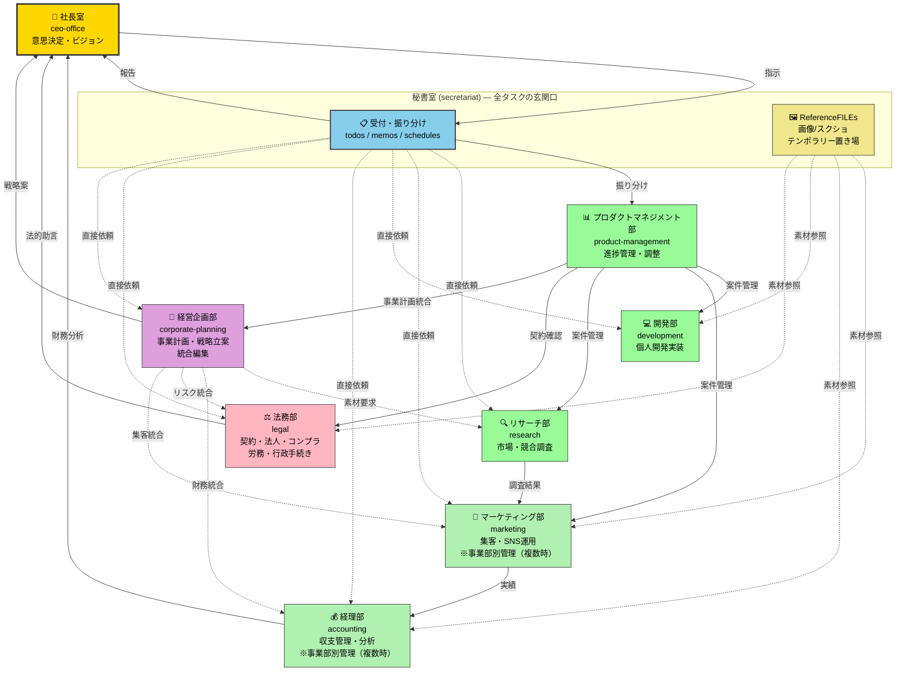
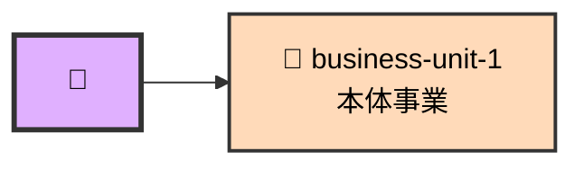
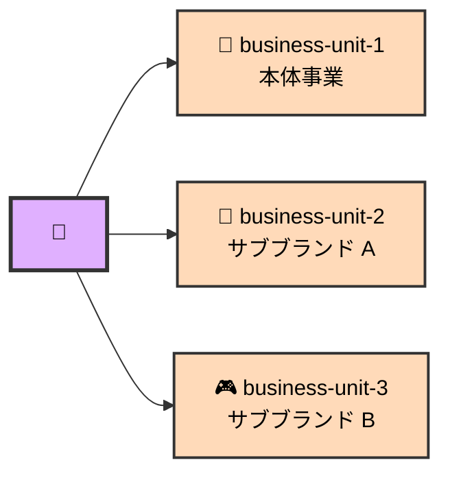

# <YOUR_COMPANY> 組織図

## 組織図（Mermaid）



## 事業部構造（デフォルト: 本体事業のみ）



事業部はあとから自由に追加可能（`business-unit-2`, `business-unit-3`, …）。
追加すると **経理部・マーケ部のサブフォルダで自動的に分離管理** される。

### 追加例（サブブランドを 2 つ持つ場合）



## 各部署の一行サマリー

| ディレクトリ | 部署名 | 役割 |
|---|---|---|
| `ceo-office/` | 社長室 | 代表社員の意思決定・ビジョン定義 |
| `secretariat/` | 秘書室 | 全指示の受付・整理・振り分け（最重要） |
| `product-management/` | プロダクトマネジメント部 | 複数案件の進捗・マイルストーン管理 |
| `research/` | リサーチ部 | 市場・競合・トレンド・ユーザー調査 |
| `marketing/` | マーケティング部 | SNS運用・コンテンツ企画・集客（事業部別） |
| `development/` | 開発部 | 個人開発プロダクトの実装 |
| `accounting/` | 経理部 | 収支記録・分析・予算提案（事業部別） |
| `legal/` | 法務部 | 契約・法人・コンプラ・PII・労務・社労士業務・行政手続き |
| `corporate-planning/` | 経営企画部 | 事業計画・戦略立案・経営KPI・中長期計画・他部署成果物の統合編集（2026-04-25 新設） |
| `secretariat/ReferenceFILEs/` | 参考資料（秘書室管轄） | 画像・スクショ等のテンポラリー置き場 |

## 基本ワークフロー

### パターンA: 思考・ToDoの吐き出し
```
社長 ──▶ 秘書室
          ├─ memos/ に思考を記録
          ├─ todos/ にタスクを記録
          └─ PM部へ共有（必要時）
```

### パターンB: 単発リサーチ依頼
```
社長 ──▶ 秘書室 ──▶ リサーチ部
                    └─ 調査 ──▶ 秘書室 ──▶ 社長
```

### パターンC: 部署連携案件（動画ステップ3相当）
```
社長 ──▶ 秘書室 ──▶ PM部
                    ├─ リサーチ部（ネタ調査）
                    │       │
                    │       ▼
                    └─ マーケ部（SNS発信用文案）
                            │
                            ▼
                    秘書室 ──▶ 社長（統合レポート）
```

### パターンD: データ分析案件（動画ステップ4相当）
```
社長 ──▶ 秘書室 ──▶ 経理部 ＋ マーケ部
                    ├─ secretariat/ReferenceFILEs/ の画像/データ読込
                    ├─ 分析（事業部別）
                    └─ 提案 ──▶ 秘書室 ──▶ 社長
```

### パターンE: 法務案件（契約・法人・コンプラ）
```
社長 ──▶ 秘書室 ──▶ 法務部
                    ├─ 契約書レビュー/法人設立書類整理
                    ├─ PII・プライバシーポリシー検討
                    └─ 意見 ──▶ 秘書室 ──▶ 社長
```

### パターンF: 事業部プロジェクト（事業部を追加した場合）
```
社長 ──▶ 秘書室 ──▶ PM部（事業部別プロジェクト）
                    ├─ 開発部（実装）
                    ├─ 法務部（PII・個人情報）
                    ├─ マーケ部（business-unit-N/ 配下）
                    └─ 経理部（business-unit-N/ 配下）
                            │
                            ▼
                    秘書室 ──▶ 社長（統合レポート）
```
※ 事業部が本体（business-unit-1）のみの場合はサブフォルダを作らず直接配置可。

## 報告ライン
- **通常時**: 部署 → 秘書室 → 社長
- **緊急時（重大発見・金額インパクト大）**: 部署 → 社長室直送 + 秘書室CC
- **意思決定事項**: `ceo-office/decisions/YYYY-MM-DD_件名.md` に記録

## 部署間連携のルール
1. 他部署に依頼する時はMarkdownで依頼文書を作成
2. 依頼文書には「依頼元・依頼先・目的・期限・成果物形式」を明記
3. 連携結果は**依頼元に返却**し、秘書室にもCC
4. 複数部署連携はPM部が調整役
5. **事業部が 2 つ以上ある場合のみ** 事業部別業務は事業部サブフォルダ（`business-unit-1/`, `business-unit-2/`, …）で区別

## 事業部別運用ルール（事業部が複数ある場合）
- マーケ部/経理部の出力は **発生した事業部サブフォルダに配置**（本体事業のみの環境ではサブフォルダ不要）
- 事業部横断の企画は `all/`（経理）または明示的に「横断」とタグ付け
- 月次/四半期レポートは事業部別 + 全社合算の両方を作成
- 事業部追加手順は `docs/SETUP.md §9 カスタマイズ「部署を追加したい」` を参照
